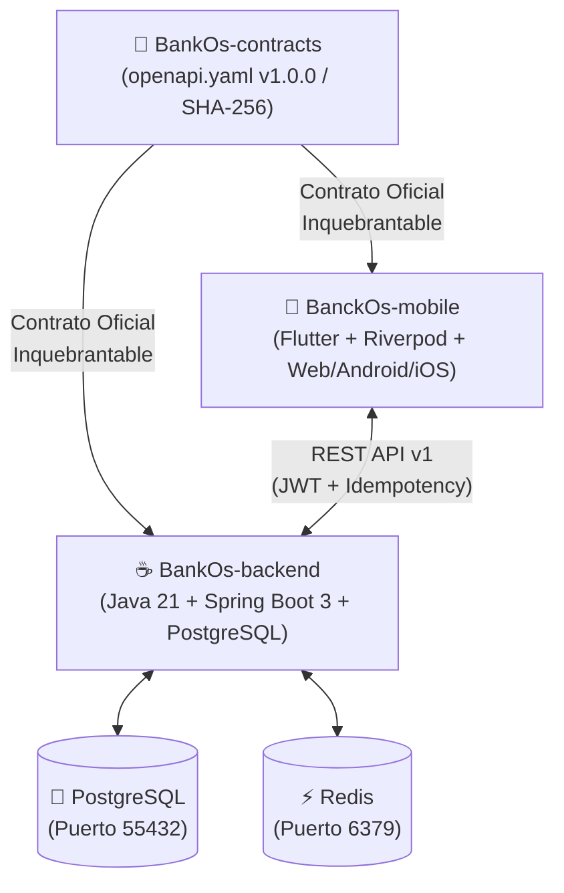

# BankOS — Plataforma Bancaria Digital Multi-Tenant

BankOS es una plataforma bancaria modular y multi-institucional diseñada bajo principios de arquitectura dirigida por contratos (*Contract-First*), alta concurrencia, idempotencia financiera y aislamiento estricto entre entidades financieras.

---

## 1. Estructura del Ecosistema y Repositorios

El proyecto está formalmente dividido en **tres repositorios Git independientes**:



### Enlaces a los Repositorios Oficiales en GitHub:
1. **[BankOs-contracts](https://github.com/dilandcv/BankOs-contracts)**: Repositorio canónico del contrato OpenAPI 3.1.0 y reglas de gobernanza.
2. **[BankOs-backend](https://github.com/dilandcv/BankOs-backend)**: Backend monolítico modular en Java 21, Spring Boot 3, PostgreSQL, Redis y Docker Compose.
3. **[BanckOs-mobile](https://github.com/dilandcv/BanckOs-mobile)**: Aplicación cliente Flutter multiplataforma (Web, Android, iOS, Desktop) con Riverpod.

---

## 2. Preguntas Frecuentes

### ¿Cuál repositorio debo clonar si quiero probar el proyecto completo?
Para probar el proyecto completo (interfaz visual Flutter interactuando en tiempo real con la base de datos y la lógica bancaria), **debes clonar dos repositorios**:
1. **`BankOs-backend`**: Para iniciar la infraestructura de datos y la API REST con Docker.
2. **`BanckOs-mobile`**: Para iniciar la aplicación móvil o web.

### ¿Para qué es el tercer repositorio (`BankOs-contracts`)?
`BankOs-contracts` es el repositorio que custodia el contrato oficial e inquebrantable de la API (`openapi.yaml`). 
- **Propósito:** Garantizar que los equipos de Frontend y Backend nunca diverjan en nombres de endpoints, estructuras de datos, tipos de parámetros o códigos de error HTTP.
- **Verificación criptográfica:** Ambos repositorios (`backend` y `mobile`) cuentan con suites de pruebas unitarias que calculan el hash SHA-256 de su copia local de `openapi.yaml` y la comparan con la versión canónica (`f454d326...`). Si alguien modifica un endpoint sin pasar por el proceso formal de RFC en `BankOs-contracts`, la suite de pruebas falla de inmediato.
- **¿Cuándo clonarlo?:** Solo cuando seas el arquitecto o diseñador de la API y necesites proponer un cambio mediante RFC.

---

## 3. Guía Paso a Paso para Ejecutar el Proyecto Completo

Sigue estos sencillos pasos para tener todo el ecosistema arriba en menos de 3 minutos:

### Paso 1: Levantar el Backend (Base de Datos, Redis y API)

En una terminal:
```bash
git clone https://github.com/dilandcv/BankOs-backend.git
cd BankOs-backend

# Configurar variables de entorno iniciales
cp .env.example .env

# Levantar PostgreSQL, Redis y Spring Boot
docker compose up --build -d
```

#### Verificación:
- **Healthcheck:** Ejecuta `curl http://localhost:8080/actuator/health`. Debe devolver `{"status":"UP"}`.
- **Swagger UI:** Abre en tu navegador `http://localhost:8080/swagger-ui.html` para explorar y probar los endpoints interactivamente.
- **Puertos del Host:**
  - API Spring Boot: `http://localhost:8080`
  - PostgreSQL: Host `55432` -> Contenedor `5432` (evita colisiones con PostgreSQL local)
  - Redis: `6379`

---

### Paso 2: Ejecutar la Aplicación Cliente (Flutter)

En otra terminal:
```bash
git clone https://github.com/dilandcv/BanckOs-mobile.git
cd BanckOs-mobile

# Descargar dependencias
flutter pub get

# Ejecutar en tu navegador Google Chrome (la opción más rápida):
flutter run -d chrome

# O ejecutar en emulador Android:
flutter run
```

#### Resolución Automática de URLs de Conexión:
- **En Web o Desktop:** La app se conecta automáticamente a `http://localhost:8080/api/v1`.
- **En Emulador Android:** La app detecta el emulador y se conecta a `http://10.0.2.2:8080/api/v1`.
- **En Dispositivo Físico:** Ejecuta con la IP local de tu máquina:  
  `flutter run --dart-define=API_BASE_URL=http://<TU_IP_LOCAL>:8080`

---

## 4. Credenciales de Prueba (Seed Oficial)

El backend inicializa una base de datos de prueba completa con usuarios, saldos y cuentas activas.

**Contraseña universal:** `Admin123!`

| Banco / Institución | Código (`tenant_code`) | Correo de Acceso | Rol Asignado |
|---|---|---|---|
| **Banco Horizonte** | `BANCO_HORIZONTE` | `admin@horizonte.com` | `TENANT_ADMIN` |
| Banco Horizonte | `BANCO_HORIZONTE` | `operador@horizonte.com` | `OPERATOR` |
| Banco Horizonte | `BANCO_HORIZONTE` | `auditor@horizonte.com` | `AUDITOR` |
| **Nequi** | `NEQUI` | `admin@nequi.com` | `TENANT_ADMIN` |
| **Daviplata** | `DAVIPLATA` | `admin@daviplata.com` | `TENANT_ADMIN` |
| **PayPal** | `PAYPAL` | `admin@paypal.com` | `TENANT_ADMIN` |
| **Bancolombia** | `BANCOLOMBIA` | `admin@bancolombia.com` | `TENANT_ADMIN` |
| **NU** | `NU` | `admin@nu.com` | `TENANT_ADMIN` |
| **BankOS Platform** | `PLATFORM` | `platform@bankos.com` | `PLATFORM_ADMIN` |

---

## 5. Capacidades Técnicas y Financieras Destacadas

- **Aislamiento Multi-Tenant Estricto:** Cada banco tiene su propia identidad visual dinámica, configuración y datos aislados. La autenticación genera un JWT específico por banco que viaja en la cabecera `Authorization: Bearer <token>`.
- **Idempotencia Financiera:** Todas las transacciones (depósitos, retiros y transferencias) exigen un header `Idempotency-Key` (UUIDv4) para evitar duplicación de cobros en caso de fallos de red.
- **Bloqueos Pesimistas:** Las cuentas se operan con `PESSIMISTIC_WRITE` a nivel de base de datos para impedir condiciones de carrera y saldos negativos.
- **Precisión Monetaria Exacta:** Tanto el backend en Java (`BigDecimal`) como el frontend en Flutter manejan montos monetarios en formato de coma fija (`NUMERIC(19,4)`), prohibiendo el uso de flotantes binarios (`double`/`float`).
- **Zero Mocks en Runtime:** 100% de las pantallas y funcionalidades operan contra endpoints reales.

---

## 6. Documentación del Proyecto y Auditoría

En la carpeta [`docs/`](./docs) de este repositorio central se encuentra la documentación técnica detallada:
- [`docs/auditoria/FASE_0_INSPECCION.md`](./docs/auditoria/FASE_0_INSPECCION.md): Diagnóstico inicial del proyecto.
- [`docs/auditoria/AUDITORIA_FRONTEND.md`](./docs/auditoria/AUDITORIA_FRONTEND.md): Auditoría completa de Flutter y Riverpod.
- [`docs/auditoria/AUDITORIA_BACKEND.md`](./docs/auditoria/AUDITORIA_BACKEND.md): Auditoría de arquitectura modular, base de datos y Spring Boot.
- [`docs/auditoria/AUDITORIA_OPENAPI.md`](./docs/auditoria/AUDITORIA_OPENAPI.md): Análisis comparativo y matriz del contrato OpenAPI.
- [`docs/auditoria/INFORME_ELIMINACION_MOCKS.md`](./docs/auditoria/INFORME_ELIMINACION_MOCKS.md): Reporte de erradicación total de mocks en tiempo de ejecución.
- [`docs/auditoria/AUDITORIA_SEGURIDAD.md`](./docs/auditoria/AUDITORIA_SEGURIDAD.md): Auditoría de seguridad OWASP y mejores prácticas.
- [`docs/PLAN_TRABAJO.md`](./docs/PLAN_TRABAJO.md): Plan de trabajo y tareas de ejecución.
- [`docs/PROGRESO.md`](./docs/PROGRESO.md): Seguimiento de completitud de tareas (100%).
- [`docs/ARQUITECTURA_REPOSITORIOS.md`](./docs/ARQUITECTURA_REPOSITORIOS.md): Guía de arquitectura de separación de repositorios.
- [`docs/DOCKER.md`](./docs/DOCKER.md): Guía de despliegue con Docker y Docker Compose.
- [`docs/INFORME_FINAL_BANKOS.md`](./docs/INFORME_FINAL_BANKOS.md): Informe final consolidado para entrega.
