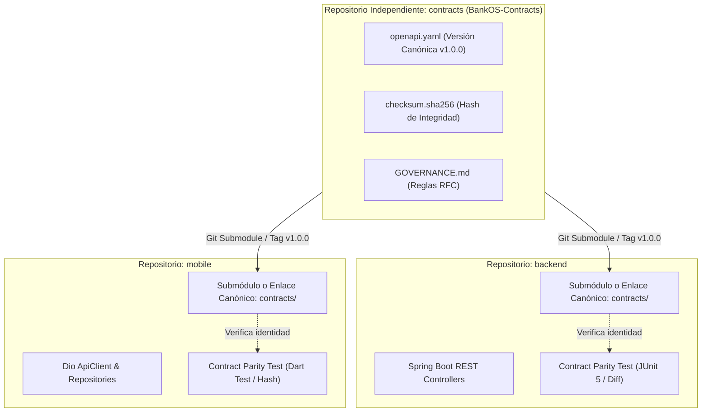

# ARQUITECTURA Y GOBERNANZA DEL CONTRATO OFICIAL OPENAPI

**Proyecto:** BankOS  
**Fecha:** 2026-11-18  
**Autor:** Senior Software Architect  
**Carácter:** Normativo y Vinculante  

---

## 1. Principio Fundamental: Única Fuente de Verdad Inquebrantable

El contrato de API definido en `openapi.yaml` es la **única fuente de verdad** que rige la comunicación entre la aplicación móvil Flutter y el backend Spring Boot.

Para cumplir con la directriz explícita de **evitar a toda costa dos archivos independientes que puedan divergir**, se establece el siguiente modelo arquitectónico:



---

## 2. Propuesta del Tercer Repositorio: `contracts`

### 2.1 Justificación
- Mantener `openapi.yaml` dentro de `backend/` genera la tentación de que los desarrolladores de backend modifiquen el contrato sin consultar al equipo frontend.
- Mantenerlo duplicado como copias manuales en `backend/` y `mobile/` garantiza divergencia inevitable con el paso del tiempo.
- Un repositorio independiente `contracts/` desacopla el ciclo de vida del contrato de la implementación del código, elevándolo al nivel de **especificación institucional**.

### 2.2 Estructura del Repositorio `contracts/`
```
contracts/
├── .git/
├── openapi.yaml               # Contrato canónico oficial OpenAPI 3.0.1
├── openapi.sha256             # Hash criptográfico SHA-256 para validación de paridad
├── README.md                  # Descripción del contrato y versionado
├── GOVERNANCE.md              # Protocolo RFC de modificación
└── scripts/
    └── verify-parity.sh       # Script de validación de integridad bit a bit
```

---

## 3. Mecanismo de Integración y Paridad Cero-Divergencia

Para asegurar que tanto `backend` como `mobile` consuman **exactamente la misma versión**:

### 3.1 Integración mediante Git Submodule (Recomendado)
- Ambos repositorios (`backend` y `mobile`) incorporan una carpeta `contracts/` vinculada como submódulo Git apuntando al commit o tag exacto (ej. `v1.0.0`) del repositorio `contracts`.
- De este modo, ambos repositorios tienen acceso local en tiempo de compilación al archivo físico sin duplicarlo manualmente.

### 3.2 Barrera de Integridad por Checksum Criptográfico (Gate de CI/CD)
Se incorpora en las suites de pruebas de ambos repositorios un test de paridad:
- **En Backend (`ContractParityTest.java`):** Lee `contracts/openapi.yaml`, calcula su SHA-256 y verifica que coincida con el hash oficial.
- **En Frontend (`contract_parity_test.dart`):** Realiza la misma comprobación.
- **Resultado:** Si un desarrollador altera localmente el contrato sin seguir el protocolo oficial, el hash no coincide y el build **falla de forma inmediata e intransigente**.

---

## 4. Protocolo Estricto de Gobernanza y Cambios (RFC de Contrato)

Queda **terminantemente prohibida** cualquier modificación unilateral al contrato. Cualquier cambio debe seguir este ciclo de 4 pasos:

1. **Solicitud de Cambio (RFC - Request for Comments):**
   - El desarrollador (frontend o backend) crea un issue o propuesta documentando: endpoint a modificar/agregar, justificación de negocio, DTOs propuestos y compatibilidad hacia atrás.
2. **Revisión y Aprobación Cruzada Obligatoria:**
   - Requiere la aprobación explícita de:
     - Lead Backend Engineer.
     - Lead Frontend Engineer.
     - Senior Software Architect / Usuario.
3. **Commit y Etiquetado en Repositorio `contracts`:**
   - El cambio se aplica exclusivamente en el repositorio `contracts`.
   - Se actualiza el número de versión semántica (ej. de `v1.0.0` a `v1.1.0`) y se regenera `openapi.sha256`.
4. **Actualización de Punteros en `backend` y `mobile`:**
   - Ambos equipos actualizan la referencia del submódulo (`git submodule update --remote`) e implementan el soporte en su código de forma sincronizada.

---

## 5. Extracción Inicial del Contrato Oficial

Para generar la versión `v1.0.0` oficial de `openapi.yaml`:
1. El backend de BankOS ya expone los 31 endpoints configurados en `OpenApiConfig.java` bajo `/v3/api-docs.yaml`.
2. Se ejecuta una prueba de extracción automatizada (`OpenApiExportTest.java`) en Spring Boot que materializa el archivo YAML estático directamente desde el contexto de la aplicación, garantizando que el contrato refleja con precisión matemática el 100% de los endpoints existentes.
3. Dicho archivo se congela como la base fundacional inmutable en `contracts/openapi.yaml`.
