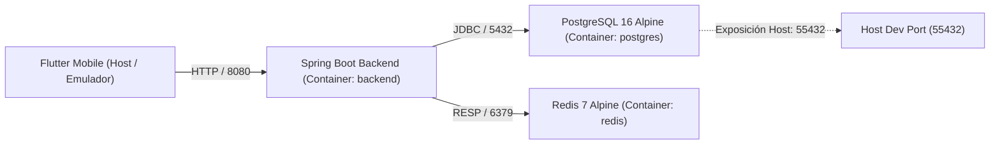

# GUÍA DE INFRAESTRUCTURA DOCKER Y ENTORNO DE DESARROLLO (FASE 7)

**Proyecto:** BankOS  
**Fecha:** 2026-11-19  
**Autor:** Senior Software Architect  

---

## 1. Arquitectura de Contenedores

La infraestructura de BankOS está orquestada mediante Docker Compose y se compone de tres servicios:



---

## 2. Configuración de Servicios y Puertos

| Servicio | Imagen | Puerto Interno | Puerto Host (Mapeado) | Justificación de Puerto |
|---|---|:---:|:---:|---|
| **postgres** | `postgres:16-alpine` | `5432` | **`55432`** | Se usa `55432` en el host para evitar colisiones con instancias locales de PostgreSQL que ocupan el puerto estándar `5432`. |
| **redis** | `redis:7-alpine` | `6379` | **`6379`** | Cache distribuido e infraestructura de mensajería. |
| **backend** | Dockerfile local (Java 21) | `8080` | **`8080`** | Servidor REST API BankOS. |

---

## 3. Comandos de Ciclo de Vida

### 3.1 Levantar Infraestructura Completa (Base de Datos + Redis + Backend)
```bash
cd backend
docker compose up -d --build
```

### 3.2 Levantar Exclusivamente Infraestructura (Para desarrollo local de Backend)
Si deseas ejecutar Spring Boot directamente desde tu IDE o terminal pero usando la base de datos y Redis en contenedores:
```bash
cd backend
docker compose up -d postgres redis
```

### 3.3 Verificación de Salud (*Healthchecks*)
```bash
docker compose ps
```
Los tres servicios disponen de comprobaciones automáticas de salud:
- **Postgres:** `pg_isready -U bankos -d bankos` (intervalo: 5s).
- **Redis:** `redis-cli ping` (intervalo: 5s).
- **Backend:** Depende de que Postgres y Redis alcancen el estado `healthy` antes de iniciar.

### 3.4 Visualizar Logs en Tiempo Real
```bash
docker compose logs -f backend
```

### 3.5 Detener los Contenedores
```bash
# Detener sin borrar datos
docker compose down

# Detener y purgar volúmenes de base de datos
docker compose down -v
```

---

## 4. Variables de Entorno y Secretos

Existe una plantilla de configuración en `backend/.env.example`:
```env
# Base de Datos
DB_PORT=55432
DB_NAME=bankos
DB_USERNAME=bankos
DB_PASSWORD=bankos

# Servidor Backend
APP_PORT=8080
SPRING_PROFILES_ACTIVE=dev

# Seguridad JWT (Cambiar en Producción)
JWT_SECRET=BANKOS_SUPER_SECRET_KEY_FOR_LOCAL_DEV_ENVIRONMENT_2026_CHANGE_IN_PROD
JWT_ISSUER=bankos
JWT_EXPIRATION_MS=3600000

# CORS
CORS_ALLOWED_ORIGINS=http://localhost:*,http://127.0.0.1:*
```

---

## 5. Conexión desde la Aplicación Móvil Flutter

- **Desde Emulador Android:** La URL base debe ser `http://10.0.2.2:8080/api/v1` (dirección loopback especial del emulador Android hacia el host).
- **Desde Simulador iOS / Navegador Web / Linux Desktop:** La URL base debe ser `http://localhost:8080/api/v1`.
- **Desde Dispositivo Físico:** Utilizar la dirección IP local de tu ordenador en la red Wi-Fi (ej. `http://192.168.1.50:8080/api/v1`).
