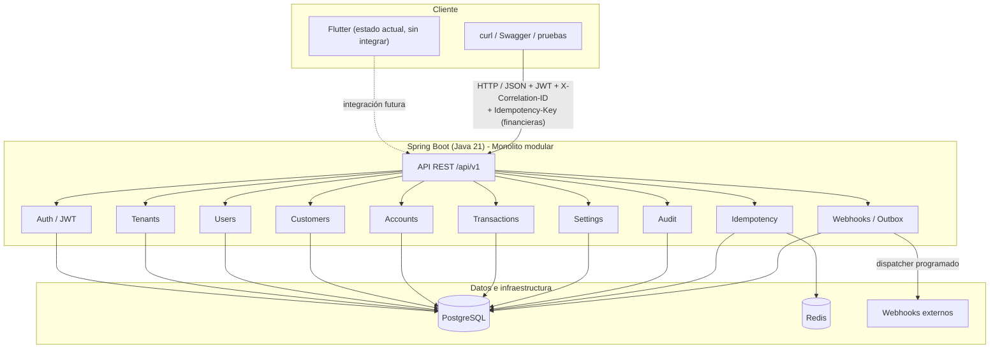
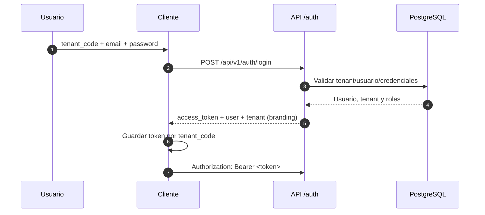

# Visión general de arquitectura — BankOS

## Estado

- **Backend implementado:** monolito modular Java 21 / Spring Boot 3.5, API REST `/api/v1`, PostgreSQL 16, Redis 7, Flyway, JWT, idempotencia, auditoría y outbox de webhooks.
- **Frontend:** `mobile/` conserva su estado actual. **No fue modificado ni conectado** al backend en esta fase.
- **Alcance actual:** backend independiente, ejecutable y verificable por sí solo.
- **Pendiente:** integración móvil, refresh tokens, RLS, rate limiting, conciliación contable, CI/CD y endurecimiento productivo.

## Objetivo arquitectónico

BankOS es una plataforma BaaS multitenant compuesta por:

- **Backend:** monolito modular en Java 21 / Spring Boot 3.5.x.
- **Persistencia:** PostgreSQL como fuente de verdad.
- **Soporte operativo:** Redis.
- **Comunicación:** API REST sobre HTTP con JSON (`/api/v1`).
- **Frontend móvil:** Flutter (Dart), feature-first; se integrará en una fase futura.
- **Repositorio:** monorepo con frontend y backend independientes.

## Diagrama general

## Responsabilidades de componentes

| Componente | Responsabilidad | Estado |
|---|---|---|
| Flutter (Dart) | UI/UX, navegación, estado, consumo de API, almacenamiento seguro de sesión. No contiene lógica financiera. | Existente, no integrado |
| Spring Boot API | Endpoints REST, autenticación/autorización, validación, reglas de negocio, aislamiento multitenant. | Implementado |
| Módulos de dominio | `tenants`, `auth`, `users`, `customers`, `accounts`, `transactions`, `idempotency`, `settings`, `audit`, `webhooks`. | Implementado |
| PostgreSQL | Persistencia transaccional, integridad referencial, fuente de verdad. | Implementado |
| Redis | Soporte auxiliar; PostgreSQL sigue siendo la fuente de verdad. | Implementado |
| Webhooks | Outbox en PostgreSQL + dispatcher programado en la aplicación. | Implementado (MVP) |
| Docker Compose | API + PostgreSQL + Redis con healthchecks. | Implementado |

## Modelo multi-banco (Opción A)

- Cada institución es un tenant independiente.
- Cada usuario pertenece a un solo tenant.
- Login por institución: `tenant_code + email + password`.
- El cliente guarda un token por institución y cambia de sesión sin volver a autenticarse.
- El `tenant_id` se toma del JWT, nunca del cliente.
- `PLATFORM_ADMIN` pertenece al tenant reservado `PLATFORM`.
- Roles: `PLATFORM_ADMIN`, `TENANT_ADMIN`, `OPERATOR`, `AUDITOR`.

Ver [modelo multi-banco](multi-bank-model.md).

## Comunicación cliente ↔ backend

- **Protocolo:** HTTP/HTTPS, JSON.
- **Base path:** `/api/v1`.
- **Headers:** `Authorization: Bearer <JWT>`, `X-Correlation-ID`.
- **Operaciones financieras:** `Idempotency-Key` obligatorio; conservar llave y cuerpo en reintentos.
- **Respuestas:** `success`, `code`, `message`, `data`, `correlation_id`.
- **Estado actual:** el backend está listo para integración; `mobile/` no consume estos endpoints todavía.

## Interacción con PostgreSQL y Redis

- **Spring Boot → PostgreSQL:** Spring Data JPA/Hibernate, transacciones SQL y migraciones Flyway.
- **Spring Boot → Redis:** Spring Data Redis para soporte auxiliar.
- **Consistencia:** PostgreSQL es la fuente de verdad; Redis no reemplaza la persistencia financiera.
- **Bloqueos:** cuentas con `PESSIMISTIC_WRITE`; sin sobregiro en el MVP.

## Flujo de autenticación

- **No implementado:** refresh tokens, revocación de sesiones y bloqueo por intentos fallidos.

## Flujo de operación financiera

1. Cliente genera `Idempotency-Key` y `X-Correlation-ID`.
2. Envía solicitud autenticada a `/api/v1/transactions/...`.
3. El backend valida JWT, extrae `tenant_id`, valida permisos y estado de cuentas.
4. Verifica idempotencia y toma advisory lock.
5. Bloquea cuentas con `PESSIMISTIC_WRITE`.
6. Calcula con `BigDecimal`, actualiza saldos y crea movimientos contables.
7. Registra auditoría y evento outbox en la misma transacción.
8. Confirma la transacción y responde.
9. El dispatcher envía webhooks después del commit.

## Aislamiento entre instituciones

- Aislamiento lógico por `tenant_id` en entidades y consultas.
- `tenant_id` desde el contexto autenticado, nunca del payload.
- Acceso cruzado responde `404` para no revelar existencia.
- **Pendiente:** RLS de PostgreSQL y claves Redis con prefijo de tenant.

## Gestión de errores

- Respuestas estandarizadas con `code`, `message`, `correlation_id`.
- Manejo centralizado con `@RestControllerAdvice`.
- Códigos documentados en `docs/api/error-handling.md`.
- El backend no expone stack traces.

## Despliegue

- **Local/desarrollo:** Docker Compose con `backend`, `postgres` y `redis`.
- **Seed demo:** perfil `dev` (`V100__dev_seed.sql`).
- **Producción:** pendiente de decisión (orquestador, CI/CD, secretos, TLS, observabilidad).

## Decisiones pendientes

- Refresh tokens y manejo de sesión expirada.
- RLS y cifrado por tenant.
- Topología del worker de webhooks y cola durable.
- Rate limiting, observabilidad y trazas distribuidas.
- CI/CD y protecciones de ramas.
- Integración de `mobile/` con el contrato actual.

## Documentación relacionada

- [Arquitectura del backend](../../backend/docs/architecture/architecture-overview.md)
- [API implementada](../../backend/docs/api/api-overview.md)
- [Contratos](../../backend/docs/api/api-contracts.md)
- [Seguridad](../../backend/docs/security/authentication.md)
- [Multitenancy](../../backend/docs/security/multitenancy.md)
- [Docker](../../backend/docs/infrastructure/docker-setup.md)
