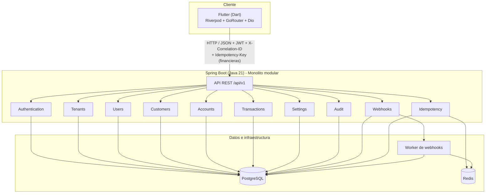
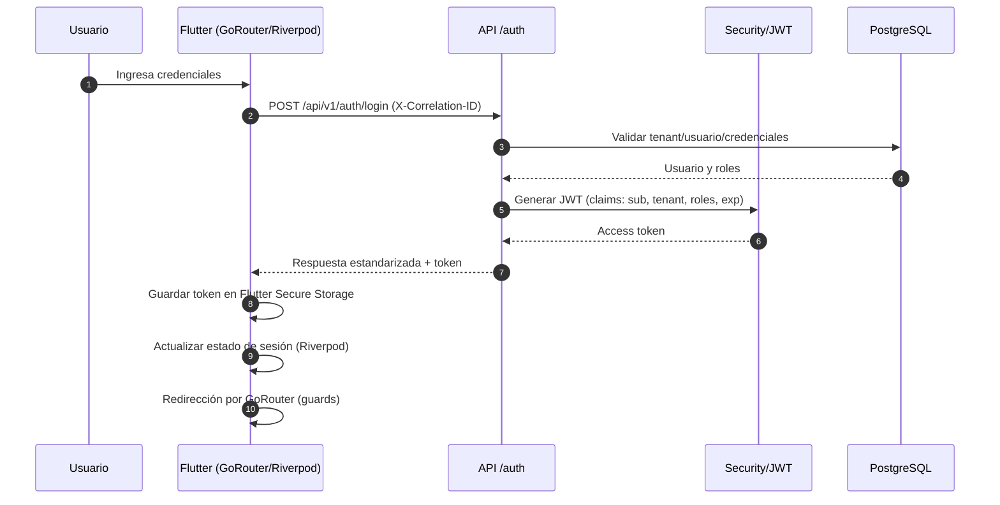

# Visión general de arquitectura — BankOS

## Estado
- **Implementado (auditado):** Ningún componente de la arquitectura objetivo está implementado. El repositorio contiene un esqueleto Flutter y un directorio `backend/` vacío.
- **Decisión objetivo:** Arquitectura descrita en este documento. Todo lo no marcado como implementado es **propuesto/pendiente**.

## Objetivo arquitectónico

BankOS es una plataforma BaaS multitenant compuesta por:
- **Frontend móvil:** Flutter (Dart), arquitectura feature-first.
- **Backend:** Monolito modular en Java 21 / Spring Boot 3.5.x.
- **Persistencia:** PostgreSQL (fuente de verdad).
- **Cache/soporte operativo:** Redis (sesiones/cache/idempotencia/soporte según diseño final).
- **Comunicación:** API REST sobre HTTP con JSON (`/api/v1`).
- **Repositorio:** Monorepo con frontend y backend independientes.

## Diagrama general (objetivo)

## Responsabilidades de componentes (objetivo)

| Componente | Responsabilidad |
|---|---|
| Flutter (Dart) | UI/UX, navegación (GoRouter), estado (Riverpod), consumo de API (Dio), almacenamiento seguro de sesión, biometría (Local Auth), generación de identificadores de operación (UUID). **No contiene lógica financiera.** |
| Spring Boot API | Exposición de endpoints REST, autenticación/autorización, validación, orquestación de casos de uso, reglas de negocio y financieras, aislamiento multitenant. |
| Módulos de dominio | `tenants`, `authentication`, `users`, `customers`, `accounts`, `transactions`, `idempotency`, `settings`, `audit`, `webhooks` (ver detalle en arquitectura backend). |
| PostgreSQL | Persistencia transaccional, integridad referencial, fuente de verdad de datos financieros y operativos. |
| Redis | Soporte para idempotencia/cache/datos efímeros y coordinación de workers (diseño pendiente de detalle). |
| Worker de webhooks | Envío asíncrono de eventos de webhook **después** de confirmar la operación en BD (objetivo). |
| Docker Compose | Orquestación local de API, PostgreSQL, Redis y worker (pendiente de implementación). |

## Comunicación Flutter ↔ Spring Boot (objetivo)

- **Protocolo:** HTTP/HTTPS, JSON (`Content-Type: application/json`).
- **Base path:** `/api/v1`.
- **Headers generales:** `Authorization: Bearer <JWT>` (cuando aplique), `X-Correlation-ID: <UUID>`.
- **Operaciones financieras:** además `Idempotency-Key: <UUID>`; la misma llave y el mismo cuerpo deben conservarse en reintentos seguros.
- **Errores y respuestas:** formato estandarizado (`success`, `code`, `message`, `data`, `correlation_id`) definido en la documentación de API.
- **Estado actual:** No hay cliente Dio configurado ni endpoints backend implementados.

## Interacción Spring Boot, PostgreSQL y Redis (objetivo)

- **Spring Boot → PostgreSQL:** vía Spring Data JPA/Hibernate; transacciones SQL para operaciones financieras; migraciones con Flyway.
- **Spring Boot → Redis:** vía Spring Data Redis para casos como idempotencia/cache (diseño específico pendiente).
- **Consistencia:** PostgreSQL es la fuente de verdad. Redis no debe reemplazar la persistencia ni la validación de integridad financiera.
- **Estado actual:** Ninguna integración configurada.

## Flujo de autenticación (objetivo, propuesto)

- **Pendiente:** Definir refresh tokens, expiración exacta, mecanismo de sesión expirada y estrategia de revocación (si aplica).

## Flujo de operación financiera (objetivo, propuesto)

1. Cliente genera `Idempotency-Key` (UUID) y `X-Correlation-ID` antes de la operación; los conserva ante reintentos.
2. Flutter envía solicitud autenticada a `/api/v1/...` con headers requeridos.
3. Backend valida JWT, extrae `tenant` del contexto autenticado (nunca del body), valida permisos y estado de cuentas.
4. Módulo de idempotencia verifica si la llave ya fue procesada para el mismo contexto/operación.
5. Servicio de transacciones ejecuta lógica dentro de transacción SQL con bloqueos de fila cuando corresponda.
6. Se persisten movimientos contables (`transaction_entries`) y se actualizan saldos de forma consistente.
7. Se registra auditoría.
8. Se confirma la transacción; eventos de webhook se despachan después de la confirmación (vía worker).
9. API responde con formato estandarizado.

> **Regla:** Las operaciones deben permitir reconstruir cambios de saldo a partir de movimientos contables.

## Aislamiento entre instituciones (multitenancy, objetivo)

- Aislamiento lógico por `tenant_id` en entidades correspondientes.
- `tenant_id` se obtiene del contexto autenticado (JWT/filtro de seguridad), **nunca** del payload enviado por Flutter.
- Todas las consultas y operaciones deben filtrar por tenant; acceso cruzado debe resultar en denegación.
- **Pendiente:** Estrategia concreta (filtro global Hibernate, especificaciones, políticas por repositorio) y pruebas de aislamiento.

## Gestión de errores (objetivo)

- Respuestas de error estandarizadas con `code`, `message`, `correlation_id`.
- Manejo centralizado de excepciones en backend (`@ControllerAdvice` u equivalente, propuesto).
- En Flutter, manejo centralizado en capa de red/errores (interceptores Dio y mapeo de errores), sin exponer detalles sensibles.
- Ver detalle en `docs/api/error-handling.md`.

## Estrategia de despliegue (objetivo, pendiente)

- **Local/desarrollo:** Docker Compose con servicios `api`, `postgres`, `redis`, `webhook-worker` (no implementado).
- **Hackatón:** ejecución local integrada; priorizar reproducibilidad del entorno.
- **Producción:** **pendiente de decisión** (orquestador, CI/CD, gestión de secretos, TLS, observabilidad).

## Decisiones pendientes

- Definición exacta de uso de Redis (idempotencia, cache, colas) y persistencia de llaves de idempotencia.
- Estrategia de refresh token y manejo de sesión expirada en móvil.
- Topología final del worker de webhooks y mecanismo de reintentos/entrega.
- Configuración de CORS, rate limiting y observabilidad (logs, métricas, trazas).
- Pipeline de CI/CD y protecciones de ramas en GitHub (no verificadas). 
