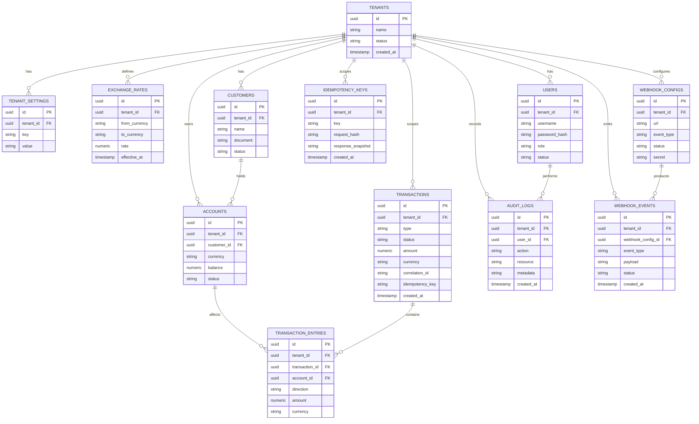

# Diseño de base de datos — BankOS

## Estado
- **Implementado (auditado):** No hay base de datos configurada en el repositorio. No existen migraciones Flyway, scripts SQL, ni configuración de datasource.
- **Decisión objetivo:** PostgreSQL como base de datos principal, migraciones con Flyway, integridad referencial y diseño multitenant.

## Principios de diseño

- **Multitenancy lógico:** `tenant_id` en entidades de negocio correspondientes; todas las consultas deben aislar datos por tenant autenticado.
- **Integridad financiera:** Transacciones SQL, restricciones, claves foráneas, e inmutabilidad de movimientos históricos.
- **Tipos monetarios:** `NUMERIC` en PostgreSQL; nunca `float`/`double`. En Java se usa `BigDecimal`.
- **Trazabilidad:** Movimientos contables reconstruibles (`transaction_entries`) y auditoría.
- **Concurrencia:** Bloqueos de fila (`SELECT ... FOR UPDATE`) en operaciones que afecten saldos (propuesto).

## Entidades objetivo

| Entidad | Propósito (resumen) |
|---|---|
| `tenants` | Instituciones financieras registradas en la plataforma. |
| `tenant_settings` | Configuración por tenant (parámetros operativos, límites, etc.). |
| `exchange_rates` | Tasas de cambio por tenant/monedas (según modelo definido). |
| `users` | Usuarios del sistema asociados a un tenant y con roles. |
| `customers` | Clientes finales de cada tenant. |
| `accounts` | Cuentas bancarias (saldo, moneda, estado, titular/customer). |
| `transactions` | Cabecera/registro de operaciones (depósito, retiro, transferencia, estado, referencias). |
| `transaction_entries` | Asientos/movimientos que explican débitos y créditos (doble efecto cuando aplique). |
| `idempotency_keys` | Registro de llaves de idempotencia para evitar duplicados. |
| `audit_logs` | Trazabilidad de acciones y eventos relevantes. |
| `webhook_configs` | Configuración de endpoints/eventos de webhook por tenant. |
| `webhook_events` | Eventos generados y su estado de entrega. |

> Los campos exactos, tipos, longitudes y restricciones detalladas son **pendientes** de definición en migraciones Flyway.

## Diagrama entidad-relación (propuesto)

> **Advertencia:** El diagrama es conceptual/propuesto para guiar el diseño. Los nombres de columnas, tipos (`string` genérico en Mermaid), nulabilidad, y relaciones M:N (si se requieren) deben concretarse en las migraciones.

## Claves, restricciones e índices (objetivo)

- **PK:** UUID en todas las tablas (recomendado).
- **FK:** Referencias con integridad referencial (`tenant_id`, `customer_id`, `account_id`, `transaction_id`, etc.). Considerar `ON DELETE RESTRICT` para datos financieros.
- **Unicidad sugerida (propuesta):** `(tenant_id, key)` en `idempotency_keys`; identificadores de negocio por tenant (ej. documento de cliente, número de cuenta) según reglas.
- **Checks sugeridos:** saldos/estados válidos, montos no negativos donde aplique, monedas en formato ISO 4217 (propuesto).
- **Índices sugeridos:** `(tenant_id, ...)` en tablas multitenant; índices por `correlation_id`, `created_at`, `account_id`, `transaction_id` para consultas frecuentes.
- **Importes:** `NUMERIC(p,s)` con precisión/escala definida por el equipo (pendiente; debe soportar decimales de moneda y conversiones).

## Estrategia multitenant

- Columna `tenant_id` en todas las entidades que pertenezcan a un tenant.
- Consultas siempre filtradas por `tenant_id` del contexto autenticado.
- Evitar claves únicas globales que permitan inferencia entre tenants; preferir unicidad compuesta con `tenant_id`.
- **Pendiente:** Decidir particionamiento, row-level security (RLS) en PostgreSQL o filtrado a nivel aplicación/Hibernate.

## Migraciones con Flyway (objetivo)

- Ubicación propuesta: `backend/src/main/resources/db/migration`.
- Convención: `V1__init.sql`, `V2__...sql`, etc., con cambios incrementales y reproducibles.
- **Estado actual:** No existen migraciones.

## Reglas financieras en persistencia

- Usar `NUMERIC` para importes; no `float`/`double`.
- No eliminar movimientos históricos (`transactions`, `transaction_entries`, `audit_logs`).
- Operaciones financieras en transacciones ACID.
- Proteger concurrencia con bloqueos de fila sobre cuentas/saldos involucrados.
- Reconstrucción de saldo posible a partir de `transaction_entries`.

## Pendientes

1. Definir modelo de datos detallado (campos, tipos, nulabilidad, constraints) y primera migración.
2. Definir precisión/escala monetaria y manejo de monedas/tasas.
3. Definir política de retención/archivado (si aplica) sin borrar historial financiero.
4. Implementar índices y validar rendimiento para consultas de historial. 
