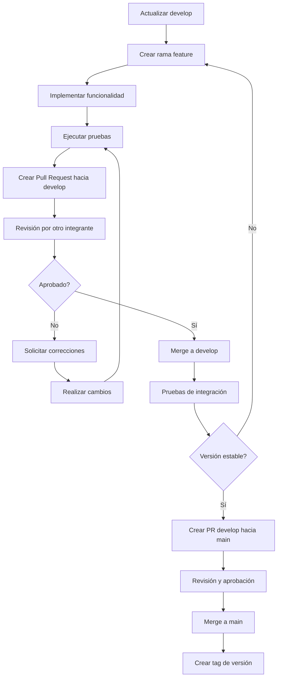

# Flujo de trabajo Git y GitHub — BankOS

## Equipo y ramas permanentes

El equipo está conformado por **4 integrantes**. Se utiliza un flujo basado en ramas permanentes `main` y `develop`.

| Rama | Propósito | Reglas |
|---|---|---|
| `main` | Versiones estables | **No permite push directo.** Solo recibe cambios desde `develop` mediante Pull Request aprobado. |
| `develop` | Integración de funcionalidades revisadas | **No permite push directo.** Recibe cambios desde ramas de trabajo mediante Pull Request aprobado. |

> **Nadie debe desarrollar directamente en `main` ni en `develop`.**

**Estado auditado:** La rama local observada es `master` sin commits y no existe `develop` en el repositorio. Las protecciones de rama en GitHub **no han sido verificadas** desde este entorno.

## Flujo de trabajo obligatorio

1. Actualizar la rama `develop` local.
2. Crear una rama independiente para la tarea.
3. Implementar los cambios correspondientes.
4. Ejecutar pruebas locales.
5. Realizar commits descriptivos (Conventional Commits).
6. Subir la rama al repositorio remoto.
7. Crear un Pull Request dirigido a `develop`.
8. Solicitar revisión a otro integrante.
9. Esperar aprobación.
10. Corregir observaciones cuando corresponda.
11. Integrar mediante merge a `develop`.
12. Eliminar la rama después de integrarla.

**Está prohibido aprobar el propio Pull Request.**

## Diagrama del flujo



## Convenciones de ramas

```text
feature/nombre-funcionalidad
fix/nombre-error
refactor/nombre-modulo
docs/nombre-documentacion
test/nombre-prueba
```

Ejemplos:
```text
feature/auth-login
feature/tenant-isolation
feature/account-management
feature/multicurrency-transfer
fix/idempotency-duplicate
docs/api-documentation
```

## Conventional Commits

Todos los commits deben seguir esta convención:

```text
feat: agregar autenticación JWT
fix: corregir validación de saldo
refactor: reorganizar módulo transactions
docs: actualizar documentación API
test: agregar pruebas de transferencias
chore: configurar Docker Compose
```

## Integración de `develop` a `main`

Los cambios siempre se integran primero en `develop`. Cuando el proyecto esté listo para una versión estable:

1. Congelar temporalmente nuevas funcionalidades.
2. Ejecutar pruebas de integración.
3. Verificar compilación de Flutter.
4. Verificar compilación de Spring Boot.
5. Verificar Docker Compose.
6. Validar transferencias.
7. Validar idempotencia.
8. Validar aislamiento multitenant.
9. Validar conversiones monetarias.
10. Crear Pull Request de `develop` hacia `main`.
11. Solicitar revisión de otro integrante.
12. Obtener aprobación.
13. Realizar merge a `main`.
14. Crear tag de versión.

**Nunca integrar funcionalidades directamente a `main`.**

## Branch Protection Rules (recomendado, no verificado)

Configurar en GitHub para `main` y `develop`:
- Requerir Pull Request antes de merge.
- Requerir al menos **1 aprobación**.
- Impedir autoaprobaciones.
- Exigir resolución de conversaciones antes de merge.
- Exigir verificaciones automáticas (CI) cuando estén disponibles.

> **Nota:** No se ha verificado que estas protecciones estén activadas en el repositorio remoto. 
